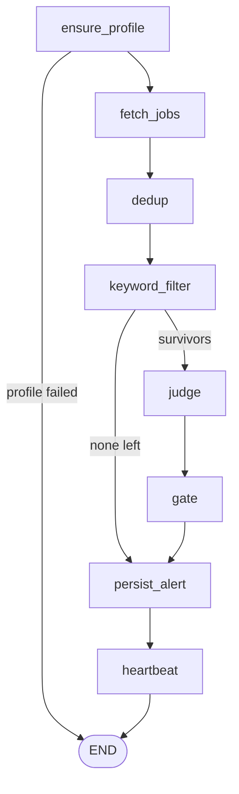

# JobRadar

**An autonomous agent that watches remote job boards, scores every listing against my resume, and pings me on Discord only when something is worth applying to.**

---

## Why I built it

Refreshing job boards by hand ate hours, and by the time I found a good listing it already had hundreds of applicants. JobRadar does the checking for me, every hour, on an old spare phone.

It is now my main channel for finding leads. It is also a sub-agent of [Jarvis](../README.md), my multi-agent assistant project: `run_cycle()` is a plain function, so a future orchestrator can call it as a worker.

## At a glance

| | |
|---|---|
| **Runs** | Hourly, unattended, on an old Android phone (Termux + cron) |
| **Brain** | LangGraph pipeline with a Groq LLM judge (`openai/gpt-oss-120b`) |
| **Memory** | SQLite, so no job is ever judged or alerted twice |
| **Output** | Discord channels using webhooks: matches, rejected (for auditing), heartbeat |
| **Evaluation** | 254 labeled listings and an `--eval-only` mode that reports false alerts and missed jobs |

## How it works



| Step | What happens | LLM? |
|---|---|---|
| **ensure_profile** | Builds a small profile from my resume. Rebuilds only if the file changed. | Only on change |
| **fetch_jobs** | Pulls each source. One source failing does not stop the rest. | No |
| **dedup** | Drops jobs already seen in the database. | No |
| **keyword_filter** | Free first pass: too many years asked, or no role or skill match. | No |
| **judge** | Scores survivors 0 to 10 and estimates monthly pay in INR. Batches of 6. | Yes |
| **gate** | Accepts only score 7+ and pay above the floor. | No |
| **persist_alert** | Saves jobs, posts to Discord, retries earlier failed posts. | No |
| **heartbeat** | One summary line per cycle. | No |

The graph works on whole lists of jobs per cycle rather than one job at a time, so LLM calls can be batched.

## Design decisions

### Cheap filters before the LLM

Rules run first, and the judge only sees survivors. Judge calls are capped at 10 per cycle (6 jobs each, 45 seconds apart). Anything over the cap is retried next cycle.

### Hosted LLM instead of local

I started with a local Qwen 2.5 3B and removed it. A 3B model was not reliable enough for fit scoring and salary estimation.

### Save first, alert second

A job is stored first and flagged as alerted only after the Discord post succeeds. If Discord is down, the job is retried at the start of the next cycle instead of being lost.

### Rules live in a plain-text file

Pay, location and job-type rules are written in `resources/additional_requirements.txt` and passed to the judge. This file is editable txt file. User can add own rules according to requirements.

### How salary is handled

- A stated salary is a hard filter.
- An unstated salary is estimated by the judge and tagged `[estimated]`.
- A stated range uses its top end.

### Why there is a heartbeat channel

Silence is ambiguous: no alerts could mean no matches, or a crash. The heartbeat separates the two. If it goes quiet, the agent is down.

### Audit trail for rejections

Rejected jobs are saved with a reason (so they are never judged twice) and posted to a `#rejected` channel. That is how I catch wrong rejections and tune the filters.
## Evaluation

I measure the pipeline against a labeled set of **254 real listings** from four sources (RemoteOK 99, Himalayas 95, Working Nomads 35, We Work Remotely 25). Each listing is labeled `accepted` (worth applying to) or `skip` by me, against my resume and the rules above. Six listings are labeled `accepted` (five distinct jobs, since one appears on two boards).

### Results so far

I ran the pipeline before and after rewriting the location and contract rules:

| | Before | After |
|---|---|---|
| Jobs the pipeline accepted | 5 | 1 |
| False alerts (accepted, but labeled skip) | 5 | 0 |
| Correct accepts | 0 | 1 |
| Missed (labeled accepted, pipeline rejected) | 6 of 6 | 5 of 6 |

What the errors showed:

- All five false alerts were location mistakes (US, Hungary, Spain, a fine-print region). Making the location rules explicit removed them.
- Four of the five remaining misses never reached the judge. The keyword filter dropped them on purpose: it rejects jobs that ask for more experience than I have, and jobs whose title and text match none of my target roles or skills. That keeps judge calls low, at the cost of some borderline jobs.

**Caveats:** I changed the prompt (additional_requirements.txt)  after seeing these errors on the same set, so the "after" numbers are optimistic. There is no held-out set yet, only a few `accepted` labels, and the judge sometimes returns no verdict for a job, so results shift a little between runs.

### Run it yourself

**1. Build and label the dataset**

```bash
python -m job_finder.jf_eval
```

This fetches listings from every source, skips ids already in `resources/eval_jobs.jsonl`, and appends new ones up to `MAX_JOBS`. It then shows each unlabeled job (title, company, salary, location, description, but never the judge's score) and asks for `accepted` or `skip`.

**2. Evaluate**

```bash
python -m job_finder.jf_graph --eval-only
```

This runs the real filter, judge and gate over the labeled jobs, with no Discord posts and no database writes. It prints the false-alert rate, the missed rate, and every wrong alert and missed job with the judge's score and reason.

## Deployment

Runs hourly on an old Android phone:

```
Termux  ->  cron (crond)  ->  run_jobradar.sh  ->  flock  ->  python -m job_finder.jf_graph
```

- Wake lock held and the phone stays plugged in
- `flock` stops overlapping runs from corrupting the database
- Secrets live in a gitignored `.env`, and the resume, generated profile and eval files are gitignored too

## Quick start

**1. Install**

```bash
pip install pypdf langgraph langchain-groq pydantic requests python-dotenv
```

**2. Add secrets** in `job_finder/.env`

```
GROQ_API_KEY=
JF_WEBHOOK_PRIMARY=
JF_WEBHOOK_SECONDARY=
JF_WEBHOOK_HEARTBEAT=
JF_WEBHOOK_REJECTED=
```

**3. Add your files** (all gitignored)

- `job_finder/resources/resume.pdf`
- `job_finder/resources/additional_requirements.txt` (pay, location and job-type rules)

**4. Try an evaluation run** (calls Groq, but writes nothing and posts nothing)

```bash
python -m job_finder.jf_graph --eval-only
```

**5. Run for real**

```bash
python -m job_finder.jf_graph
```

## Known limitations

| Limitation | Detail |
|---|---|
| Strict keyword filter | By design it drops about 85% of listings before the judge, so a borderline job can be lost there. Its years rule also reads a range written with an en dash ("4–5 years") as 5, and can count company-history numbers such as "30 years of market presence" as an experience requirement. |
| Small, shared eval set | 254 listings with six `accepted` labels, labeled by one person, and used for both tuning and measuring. Good for catching false alerts, too small for a reliable miss rate. |
| Judge sometimes skips a job | It occasionally returns no verdict for one or a few jobs in a batch. In production they are retried next cycle, but the eval run does not retry them. |
| Jobs with unknown pay are rejected | A strong match with unstated pay is rejected by the gate. I plan to send these to `#secondary` for a manual check instead. |
| Indirect apply links | All current sources link through their own pages, so every match goes to `#secondary`. `#primary` stays empty until the ATS sources exist. |
| LLM-only pay estimates | Currency conversion and salary guesses come from the judge. A job near the floor can be wrongly dropped, which is why `#rejected` exists. |
| Staffing postings leak through | I keep a company deny list and extend it from `#rejected`. |
| Plain INSERT in `save_job` | Overlapping runs raised a UNIQUE error once. `flock` prevents it in practice. `INSERT OR IGNORE` is the unapplied code fix. |
| Thin profile | No deny terms, no strong versus familiar skill split, no dealbreakers. |
| Fragile phone hosting | If Termux closes or the phone reboots, cron must be restarted by hand. A server or Docker would fix this. |

## Roadmap

- [x] Core pipeline: profile, filters, judge, gate, Discord, SQLite
- [x] Himalayas, RemoteOK, Working Nomads and We Work Remotely sources
- [x] Hourly deployment on a phone
- [x] Labeled evaluation set and `--eval-only` mode
- [x] Explicit location and contract rules, which removed the false alerts in the first evaluation
- [ ] Deterministic location filter before the judge
- [ ] Send high-score jobs with unknown pay to `#secondary` instead of rejecting them
